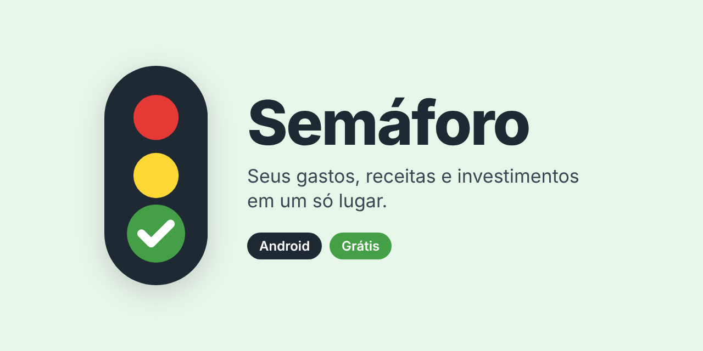
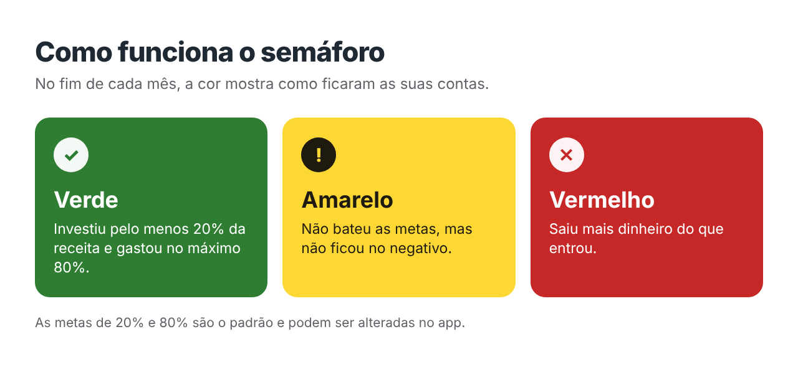

<p align="center">
  
</p>

<p align="center">
  <a href="https://github.com/semaforofinancas/semaforo-download/releases/latest"></a>
  <a href="https://github.com/semaforofinancas/semaforo-download/releases"></a>
  
</p>

<h3 align="center">
  <a href="https://semaforo-01.web.app/baixar">📲 Baixar o Semáforo para Android</a>
</h3>

---

O **Semáforo** é um app de finanças pessoais que funciona como uma planilha mensal: você registra o que entra e o que sai, e a cor do mês mostra se as suas contas estão em dia.

Sem integração com banco: você lança tudo manualmente e o app nunca pede senha de banco.

> **Versão beta:** o app está em testes com um grupo pequeno. Se encontrar algum erro, conte pelo próprio app, em **Ajustes → Enviar sugestão**.

<p align="center">
  
</p>

## O que o app faz

- **Receitas, despesas, cartão e investimentos**, com compras parceladas e fatura no mês seguinte
- **Semáforo do mês** com metas que você pode ajustar
- **Visão anual** e histórico de qualquer mês
- **Relatório em PDF** por mês, ano ou período
- **Arrastar para marcar como paga ou excluir**, com opção de desfazer
- **Copiar lançamentos do mês anterior**, para não digitar tudo de novo
- **Temas claro, escuro e noturno**, com cor de destaque à sua escolha
- **Login com Google ou e-mail**: os dados ficam salvos na sua conta e aparecem em outro celular

## Como instalar

1. No celular, abra **[semaforo-01.web.app/baixar](https://semaforo-01.web.app/baixar)** e toque em **Baixar para Android**.
2. Abra o arquivo baixado.
3. Se o celular pedir, permita instalar apps desta origem.
4. Toque em **Instalar**. Se o Play Protect avisar, toque em **Mais detalhes** → **Instalar mesmo assim**. O aviso aparece porque o app não vem da Play Store.

**Para atualizar:** quando houver versão nova, o app avisa ao abrir. Toque em **Atualizar**, baixe e instale por cima, sem desinstalar. Os seus dados continuam na sua conta.

**Requisitos:** Android 7 ou mais novo, processador de 64 bits e serviços do Google (Play Store).

## Segurança

Baixe o Semáforo somente pela [página oficial](https://semaforo-01.web.app/baixar) ou pelas [releases deste repositório](https://github.com/semaforofinancas/semaforo-download/releases).

Todas as versões são assinadas com o mesmo certificado. Para conferir, use o `apksigner` do Android SDK:

```bash
apksigner verify --print-certs semaforo.apk
```

O resultado precisa mostrar este SHA-256:

```
92:ED:4D:C8:91:C1:2B:1A:B6:F8:9E:0E:E7:DA:34:9B:09:84:FC:CA:7E:AA:11:5D:23:A6:0E:B0:A1:46:E3:BB
```

## Privacidade

- Cada pessoa acessa só os próprios dados.
- Você pode excluir a conta e todos os dados pelo próprio app, ou seguindo [estas instruções](https://semaforo-01.web.app/excluir-conta).

## Contato

Dúvidas, problemas para instalar ou sugestões: **[semaforofinancas@gmail.com](mailto:semaforofinancas@gmail.com)**

---

<sub>Este repositório guarda apenas os arquivos de instalação do app. O código-fonte não é público.</sub>
